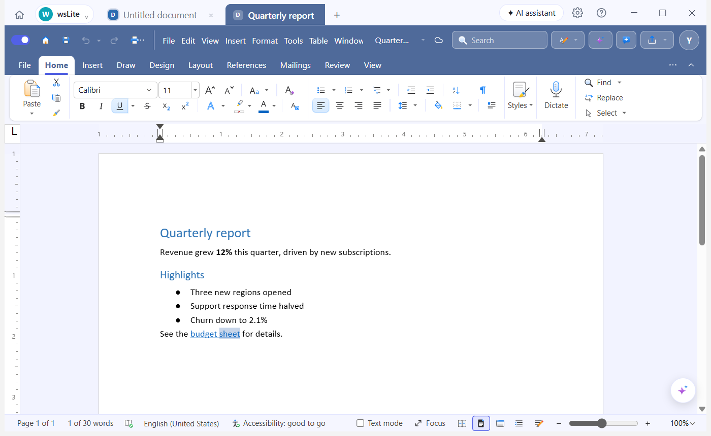
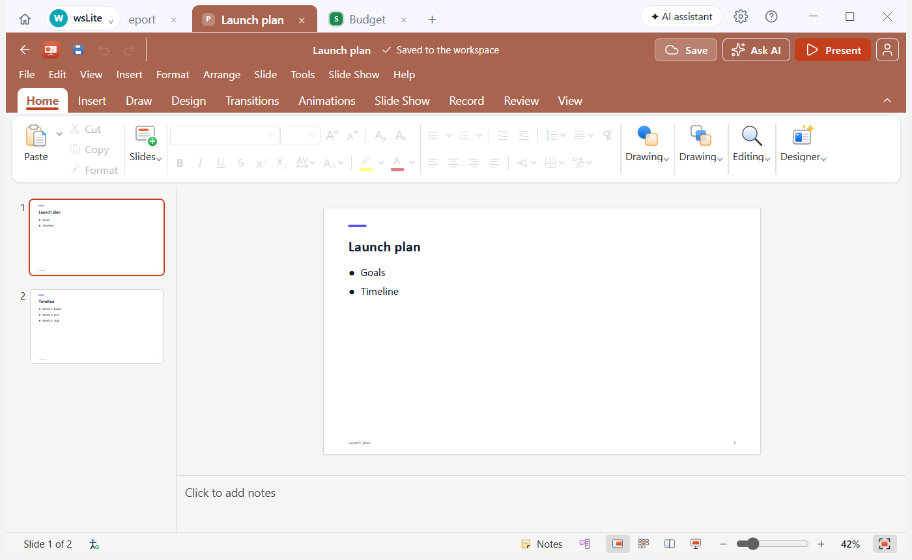
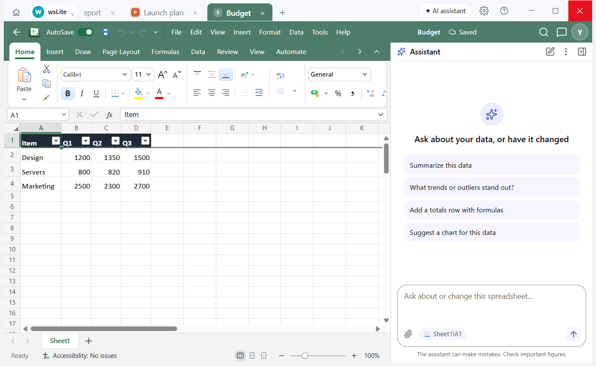

# Atelier Lite

**Documents, slides, sheets and PDFs, in one workspace.**

Atelier Lite is a Windows desktop suite that puts a word processor, a slide editor, a spreadsheet and a PDF editor in one window. They share one folder, one set of tabs and one AI assistant that can read across all of them and create new files. It is the lighter edition of Atelier: the same engine, with the four office apps only.

Made for people who work with ordinary Office files every day and want one calm place to do it, on any PC, including older and low-spec ones.

> Status: **private repository, version 1.0.0.** The site is in [`atelier-lite-site`](https://github.com/mathanmj92/atelier-lite-site). A licence has not been chosen yet; see [Licence](#licence).



## What it does

- **Four apps, one window.** Documents (`.docx`), Presentation (`.pptx`), Spreadsheet (`.xlsx`, `.csv`) and PDF Editor (`.pdf`). Every file opens in its own tab, and you can keep several of the same app open at once.
- **Opens and saves real Office files.** No import step and no private format; what you save is a normal `.docx`, `.pptx`, `.xlsx` or `.pdf` that other programs open.
- **Workspaces.** A workspace is a folder. The welcome screen lists the ones you used recently, and you can create one, open one or open an `.atle` project file. Home shows every file in the workspace, with rename and delete.
- **Works offline.** The apps are bundled, so there is no account and no cloud storage. Files stay on your PC.
- **AI assistant, your choice of engine.** Claude Code, Codex, local models (Ollama, LM Studio, llama.cpp), the Anthropic API, any OpenAI-compatible API, or your own command. It can read your files and create new documents, slides and sheets. Nothing is sent anywhere until you pick an engine and ask.
- **Links between files.** `Ctrl+Shift+K` links the document you are writing to a slide deck, a sheet or a PDF in the same workspace.
- **Workspace lock.** Optional: a password, PIN or security question encrypts the workspace's files (AES-256-GCM) and a recovery key opens it if you forget.
- **Easy on the eyes and on the PC.** Light, dark and colour themes, adjustable text size, and a Low-power mode that reduces motion and puts idle tabs to sleep.
- **Safe by default.** Asks to save the session when you close, keeps recent workspaces, and has a built-in Report a problem button.

## Screenshots

| Presentation | Spreadsheet |
| --- | --- |
|  |  |

## Install

Download **Atelier Lite Setup 1.0.0.exe** from the [Releases](https://github.com/mathanmj92/atelier-lite/releases/latest) page (about 160 MB) and run it. It installs for the current user and does not need administrator rights.

Windows SmartScreen may say the app is from an unknown publisher, because the installer is not code-signed yet. Choose **More info**, then **Run anyway**.

Silent install, for deploying to several PCs:

```
"Atelier Lite Setup 1.0.0.exe" /S
```

It installs beside the full Atelier without touching it: its own folder, its own settings, and a default workspace folder at `Documents\Atelier Lite`.

## Run from source

You need [Node.js](https://nodejs.org) 20 or newer and Windows 10 or 11.

```
npm install
npm run sync      # copy each bundled app's build into apps/
npm start         # run the app
```

## Build the installer

```
npm run dist:win
```

The installer is written to `release/`. It is a standard NSIS installer built by electron-builder.

## Tests

```
npm test
```

Runs the checks that do not need a window: the colour palettes, the wording clean-up of the bundled apps, the writer and reader the assistant uses for `.docx`, `.pptx` and `.xlsx`, and the encryption vault. See [`tests/README.md`](tests/README.md).

## How it is built

| Part | Folder | What it is |
| --- | --- | --- |
| Main process | [`electron/`](electron) | Windows, tabs, workspaces, the vault, the AI layer, file reading and writing |
| Shell | [`shell/`](shell) | The tab strip, Home, Settings, the AI panel and the welcome screen |
| Bridge | [`shim/`](shim) | Lets the bundled apps run offline, saves to the workspace folder, applies the theme |
| Apps | [`apps/`](apps) | Documents, Presentation, Spreadsheet and PDF Editor, served from `app://` |
| Scripts | [`scripts/`](scripts) | `sync-apps.mjs` copies the app builds into `apps/` |
| Docs | [`docs/`](docs) | User guide, architecture, changelog and open-source notices |

Electron 45 with one `WebContentsView` per tab. The full picture is in [`docs/ARCHITECTURE.md`](docs/ARCHITECTURE.md).

## Documentation

- [User guide](docs/USER_GUIDE.md), also in the app under **F1**
- [Architecture](docs/ARCHITECTURE.md)
- [Changelog](CHANGELOG.md)
- [Contributing](CONTRIBUTING.md) and [Security policy](SECURITY.md)
- [Open-source notices](docs/NOTICES.md)

## Licence

The repository is **private and has no licence yet**. Atelier Lite bundles four web apps and several libraries that each have their own licence, listed in [`docs/NOTICES.md`](docs/NOTICES.md) and inside each `apps/<name>/` folder. A licence for Atelier Lite's own code will be added after the licences of those bundled apps have been checked against their upstream sources, and before the repository is made public.

"Claude", "Codex", "Ollama", "LM Studio" and other product names belong to their owners. Atelier Lite only connects to tools you choose to install or sign in to.
